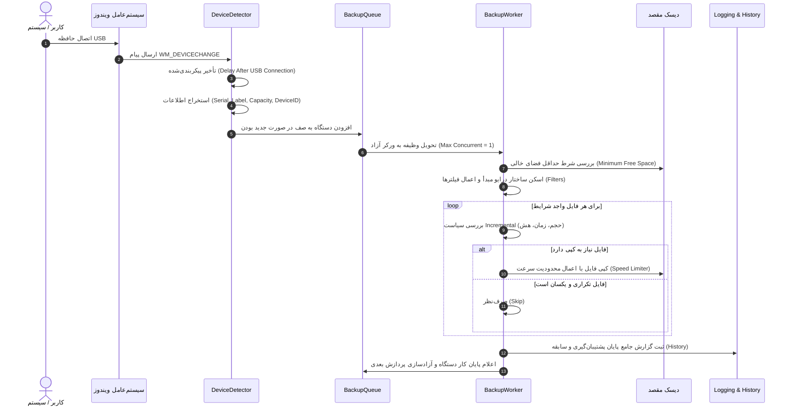
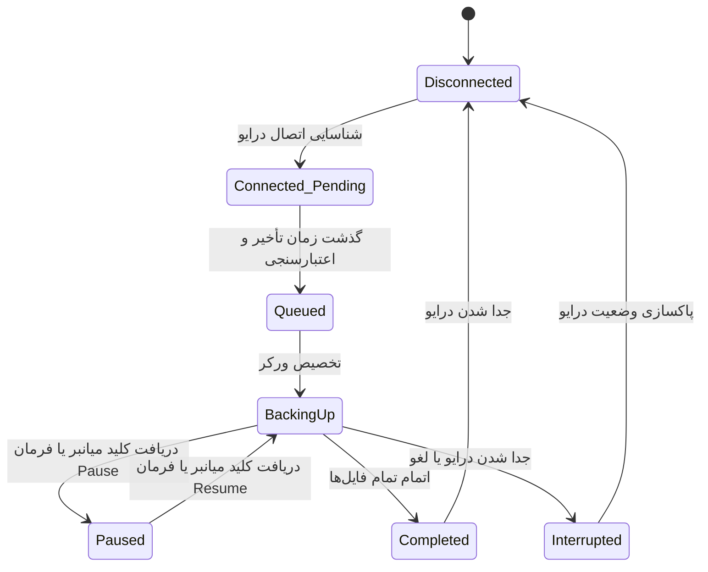
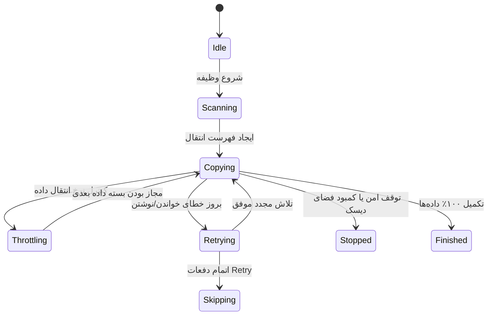

# سند معماری و طراحی فنی USBSilentCopy (نسخه ۱.۰)

این سند معماری فنی، ساختار مؤلفه‌ها، جریان داده، ماشین‌های وضعیت، مدل پیکربندی و استراتژی مدیریت خطای نرم‌افزار **USBSilentCopy** را تشریح می‌کند.

---

## ۱. نمای کلی معماری (Architecture Overview)

نرم‌افزار بر پایه معماری ماژولار و رویدادمحور (Event-Driven & Modular Layered Architecture) در بستر ‎.NET 8/10 (C#)‎ برای سیستم‌عامل ویندوز طراحی شده است.

```mermaid
flowchart TD
    subgraph OS_Layer [Windows OS / Hardware]
        USB[USB / Removable Drive]
        WinAPI[Win32 Device Notification / WM_DEVICECHANGE]
        FS[NTFS / FAT32 / exFAT File System]
    end

    subgraph Infrastructure_Layer [Infrastructure & System Integration]
        SingleInstance[Single Instance Mutex]
        HotKeyMgr[Global HotKey Manager (Ctrl+O+P)]
        DevDetector[Device Detector (Win32 + WMI Fallback)]
        StartupMgr[Startup Registry Manager]
    end

    subgraph Core_Engine [Core Engine & Queue]
        ConfigMgr[Configuration Manager]
        DevSM[Device State Tracker]
        TaskQueue[Priority Backup Queue]
        ProfileMgr[Profile Manager]
    end

    subgraph Processing_Layer [Backup & Processing Engine]
        FilterEngine[Filter Engine (Ext, Category, Date, Size)]
        BackupWorker[Backup Worker Engine]
        ThrottledStream[Throttled Copy Stream]
        DiskGuard[Disk Space Protector]
    end

    subgraph Persistence_Layer [Persistence & Telemetry]
        LogMgr[Logging & Rotation Manager]
        HistoryMgr[History Manager (JSON & CSV Export)]
    end

    subgraph Presentation_Layer [UI / Background Controller]
        AppCtrl[App Lifecycle Controller]
        TrayUI[Tray Dashboard & Settings Editor]
    end

    USB -->|Plug / Unplug| WinAPI
    WinAPI --> DevDetector
    DevDetector --> DevSM
    DevSM -->|New USB Event| TaskQueue
    ConfigMgr --> TaskQueue
    ProfileMgr --> TaskQueue
    TaskQueue --> BackupWorker
    BackupWorker --> FilterEngine
    BackupWorker --> ThrottledStream
    BackupWorker --> DiskGuard
    ThrottledStream --> FS
    BackupWorker --> LogMgr
    BackupWorker --> HistoryMgr
    AppCtrl --> SingleInstance
    AppCtrl --> HotKeyMgr
    AppCtrl --> TrayUI
```

---

## ۲. تفکیک مؤلفه‌ها (Component Breakdown)

| ماژول | مسئولیت اصلی | وابستگی‌ها |
| :--- | :--- | :--- |
| **Core** | مدیریت چرخه عمر برنامه، سیگنال‌های توقف/ازسرگیری، مدیریت لغو (CancellationToken) | پایه |
| **DeviceDetection** | دریافت پیام‌های `WM_DEVICECHANGE` از طریق پنجره مخفی، استخراج مشخصات درایو (`DriveInfo`, Win32 API, WMI) | Win32 API, Core |
| **Configuration** | اعتبارسنجی، ذخیره و بارگذاری امن `config.json` با قابلیت بازنشانی به پیش‌فرض در صورت خرابی | JSON Serializer |
| **Profiles** | تولید و نگهداری پروفایل‌های اختصاصی بر اساس شناسه سخت‌افزاری/سریال نامبر | Configuration |
| **Queue** | صف‌بندی درایوهای متصل براساس حرف درایو و اولویت؛ اجرای ترتیبی یا با همروندی کنترل‌شده | Core |
| **Filters** | بررسی دسته‌بندی فایل، پسوند، بازه تاریخی، حجم و پوشه‌های مستثنی شده | Core |
| **BackupEngine** | کپی ترتیبی، مقایسه تجمعی (Incremental)، محدودسازی پهنای باند و جابجایی (Move) | Filters, Core |
| **Infrastructure** | بررسی فضای آزاد دیسک، قفل Mutex تک‌نسخه‌ای، ثبت رجیستری Startup، کلید میانبر `Ctrl+O+P` | Win32, Registry |
| **Logging** | نگارش لاگ‌های روزانه، لاگ عملیات، خطاها و لاگ به ازای هر دستگاه با چرخش خودکار (Rotation) | File System |
| **History** | نگهداری سابقه جامع سشن‌های پشتیبان‌گیری و دستگاه‌ها با قابلیت خروجی JSON و CSV | File System |
| **UI** | کنترلر حالت خاموش (Silent Mode)، سینی ویندوز (Tray) و فرم مدیریت و تنظیمات | Windows Desktop |

---

## ۳. جریان داده (Data Flow)



---

## ۴. ماشین حالت (State Machines)

### ۴.۱. ماشین حالت وضعیت دستگاه (Device State Machine)



### ۴.۲. ماشین حالت موتور پشتیبان‌گیری (Backup Task State Machine)



---

## ۵. استراتژی مدیریت خطا و پایداری (Error Handling Strategy)

۱. **قطع ناگهانی USB در حین کپی (USB Disconnect):**
   - سیستم در هر مرحله، دسترسی به مسیر منبع را اعتبارسنجی می‌کند. در صورت عدم دسترسی، فایل در حال کپی به عنوان فایل ناقص حذف می‌شود تا فایل خراب در مقصد نماند.
   - وضعیت سشن به `Interrupted` تغییر کرده و خطای مربوطه ثبت می‌شود.
۲. **کمبود فضای ذخیره‌سازی مقصد (Disk Space Protection):**
   - پیش از نوشتن هر فایل و در حین کپی استریم، فضای آزاد درایو مقصد پایش می‌شود. اگر فضای باقی‌مانده کمتر از `MinimumFreeSpaceMb` شود، عملیات متوقف و هشدار لاگ ثبت می‌شود.
۳. **خطای دسترسی و فایل‌های قفل‌شده (File Lock / Permission Denied):**
   - در صورت خطای قفل یا مجوز، بر اساس پارامترهای `RetryCount` و `RetryDelaySeconds` تلاش مجدد صورت می‌گیرد. هرگز پنجره درخواست ادمین (UAC) به کاربر تحمیل نمی‌شود.
۴. **تک‌نسخه‌ای بودن برنامه (Single Instance):**
   - با استفاده از `System.Threading.Mutex` سراسری، از باز شدن همزمان دو نسخه از برنامه جلوگیری می‌شود.
۵. **لغو امن و آزادسازی منابع (Graceful Shutdown):**
   - کلیه چرخه‌ها به `CancellationToken` متصل هستند. در هنگام خروج کاربر یا سیستم‌عامل، فایل باز بسته شده و لاگ‌ها به شکل Flush ذخیره می‌شوند.

---

## ۶. نقشه راه پیاده‌سازی (Implementation Roadmap)

- **گام ۱:** پایه‌ریزی ساختار پروژه، لایه‌ها و مدل‌های داده (Data Models & Core Types).
- **گام ۲:** پیاده‌سازی ماژول تنظیمات (`ConfigurationManager`) و طرح‌واره (`config.json`).
- **گام ۳:** پیاده‌سازی ماژول ثبت گزارش (`LoggingManager` با قابلیت لاگ روزانه و چرخشی) و تاریخچه (`HistoryManager`).
- **گام ۴:** پیاده‌سازی فیلترها (`FilterEngine`) و پروفایل‌های اختصاصی (`ProfileManager`).
- **گام ۵:** پیاده‌سازی جریان کپی محدودشده و ایمن (`ThrottledStream`، `IncrementalChecker` و `BackupEngine`).
- **گام ۶:** پیاده‌سازی صف پردازش وظایف (`BackupQueue`) و پایش وضعیت دیسک (`DiskGuard`).
- **گام ۷:** پیاده‌سازی رهگیری درایوهای USB با Win32 و پنجره پیام (`DeviceDetector`).
- **گام ۸:** پیاده‌سازی کنترلر سراسری میانبر (`Ctrl+O+P`) و تنظیمات استارتاپ رجیستری.
- **گام ۹:** پیاده‌سازی رابط کاربری مدرن سبک و سینی ویندوز (Tray Dashboard + Settings View) با امکان Silent Mode.
- **گام ۱۰:** تدوین آزمون‌های خودکار، مستندات فارسی و انگلیسی، و اسکریپت بیلد پورتابل تک‌فایل (Single File Exe).
